# Ditto memory agent (Rust)

A memory agent harness for the Ditto subnet (Bittensor SN118). It serves an HTTP API, holds each user's
records in memory, retrieves evidence for a request, and runs a bounded loop between a language model and tools until
it has an answer.

It began as a faithful port of a Python reference agent. The port's defining rule still shapes the code: for the same
case, the Rust agent must send the model **byte-for-byte the same requests**. Model calls are cached by request
content, so the two agents can be compared by replaying cached runs and counting misses.

## Highlights

- **Declared model stages.** Router, spelling reading, deciding loop, second draft, final check and recovery each have
  a stated input, role and fallback. See [PIPELINE.md](PIPELINE.md).
- **Hybrid retrieval.** Dense embeddings and a typo-tolerant BM25 index, fused by reciprocal rank, with alias-aware
  search and exact identifier lookup.
- **Evidence selectors.** Deterministic modules surface what plain retrieval misses: who holds a project now, which
  statement superseded which, what an event history adds up to, and which notes continue a plan.
- **Sandboxed `run_python`.** Model-written programs are validated with CPython's own `ast`, then run in a separate
  process with CPU, memory, file and process limits and an import allowlist.
- **Tool calls with accountable outcomes.** Every call gets a delivery state, and a call that may have reached the
  endpoint is never replayed.
- **Python semantics in Rust.** Code-point string lengths, CPython `repr`, `json.dumps` output, float text and `re`
  behaviour are reproduced so that prompts stay identical.

## How a request flows

```mermaid
flowchart TD
    A["POST /run"] --> B["Spelling reading<br/>(advisory)"]
    A --> C["Router<br/>(advisory)"]
    B --> D["Build context<br/>retrieval + evidence notes"]
    C --> D
    D --> E["Deciding loop<br/>up to 12 model turns"]
    E -->|tool call| F["Memory tools, run_python<br/>or tool endpoint"]
    F --> E
    E -->|reply on the tool path| I["Typography normalization"]
    E -->|reply on the memory path| G["Second draft<br/>(when time allows)"]
    G --> H["Final check<br/>corrects or keeps the draft"]
    H --> I
    E -->|no reply| J["Recovery<br/>last-resort call"]
    J --> I
    I --> K["final_text, tool_calls, usage"]
```

Each request has a 270-second budget. The harness keeps a reserve for the answer, tells the model when time is nearly
up, and contains failures: a dependency that fails never fails the request. The complete rules are in
[PIPELINE.md](PIPELINE.md).

